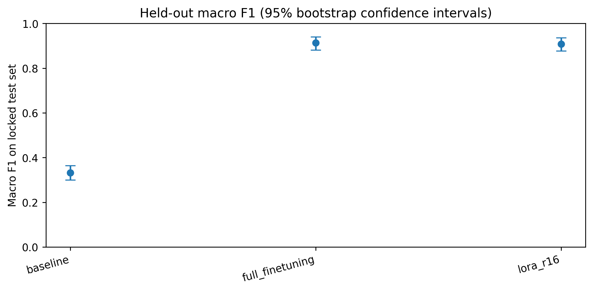
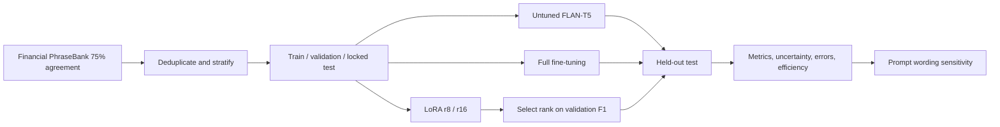

# Financial Sentiment Classification with FLAN-T5
### Comparative evaluation of baseline inference, full fine-tuning and low-rank adaptation

**Sampath Adimalla** · Student ID **17522555** · Coventry University · **7043SCN — Generative AI and Reinforcement Learning** · Task 1

> **Experiment status:** The uploaded Colab results archive contains completed baseline, full fine-tuning, LoRA (r=8 and r=16), held-out test evaluation and prompt-sensitivity experiments. The figures and tables below are extracted from the saved result files, not illustrative estimates.

## Research question

How do full fine-tuning and Low-Rank Adaptation (LoRA) compare with an untuned FLAN-T5 Small baseline on classification effectiveness, computation cost and sensitivity to instruction wording in financial-news sentiment analysis?

The study uses the 75%-agreement subset of Financial PhraseBank and a fixed stratified split. The model predicts **negative**, **neutral**, or **positive** using deterministic label generation. LoRA rank selection is performed **on validation data**, before accessing the held-out test set.

## Results at a glance

| Configuration | Test accuracy | Test macro F1 | Trainable parameters | Training time | Peak training GPU allocation |
|:--|--:|--:|--:|--:|--:|
| Untuned baseline | 33.78% | 33.23% | 0 | — | — |
| Full fine-tuning | 91.89% | **91.33%** | 76,961,152 | 360.30 s | 1.747 GiB |
| LoRA, rank 16 | 91.70% | **90.85%** | 688,128 | 192.87 s | 0.757 GiB |

**Scope:** 518 held-out Financial PhraseBank examples, seed 42, a single recorded NVIDIA Tesla T4 run. Accuracy and F1 are classification metrics and do **not** represent assessment grades. Memory is **allocated GPU memory**, not full hardware power or utilisation.

The paired bootstrap interval for the macro-F1 difference (LoRA minus full fine-tuning) includes zero. Thus the two adapted methods are similar **on this sample**, without evidence of a reliable advantage for either one. Under a different instruction prompt, macro F1 fell to 80.87% for full fine-tuning and 63.57% for LoRA; this finding exposes a substantive robustness limitation rather than proving performance across arbitrary prompts.



## Experimental workflow



### Data and controls

- **Source:** [Financial PhraseBank](https://huggingface.co/datasets/takala/financial_phrasebank), originally described by Malo *et al.* (2014); no original news sentences are redistributed in this repository.
- **Rows:** 3,453 before normalized deduplication; 3,448 after removing five duplicate rows.
- **Split:** 2,412 train / 518 validation / 518 test; hashed IDs and split labels are preserved in [`results/artifacts/split_manifest.csv`](results/artifacts/split_manifest.csv).
- **Hardware:** NVIDIA Tesla T4 (reported GPU memory 14.56 GiB), with the exact runtime and software metadata in [`results/artifacts/runtime_config.json`](results/artifacts/runtime_config.json).
- **Method control:** The same corpus, held-out test, prompt and deterministic decoding for baseline, FFT and selected LoRA. Learning rates differ as documented method-specific hyperparameters; this is a comparison of **training configurations**, not an isolated causal estimate of method choice.

## Repository navigation

| Location | Purpose |
|:--|:--|
| [`Sampath_Adimalla_17522555_7043SCN_Task1_Financial_Sentiment_FineTuning.ipynb`](Sampath_Adimalla_17522555_7043SCN_Task1_Financial_Sentiment_FineTuning.ipynb) | End-to-end primary Colab experiment |
| [`task1_pipeline.py`](task1_pipeline.py) | Standalone Python version of the experimental pipeline |
| [`requirements.txt`](requirements.txt) | ML dependency specification used in the original run |
| [`results/artifacts/`](results/artifacts/) | Provenance, split manifests, configuration, model card and rank selection |
| [`results/reports/`](results/reports/) | Metrics, CIs, prompt evaluation and error analyses |
| [`results/predictions/`](results/predictions/) | Hashed-ID prediction evidence, without original sentences |
| [`results/logs/`](results/logs/) | Recorded optimisation histories |
| [`results/figures/`](results/figures/) | Publication-ready plots in PNG and SVG |
| [`paper/`](paper/) | IEEE paper PDF and editable LaTeX source/figures |
| [`tests/`](tests/) | Structural and scientific offline checks |
| [`scripts/verify_results.py`](scripts/verify_results.py) | Recomputes key test metrics from recorded predictions |
| [`docs/`](docs/) | Experimental protocol and reproducibility documentation |

## Reproduce the study

**Google Colab (primary route)**

1. Upload the root notebook to [Google Colab](https://colab.research.google.com/).
2. Choose **Python 3 + T4 GPU** or stronger; use the original documented configuration for like-for-like comparisons.
3. Execute the installation cell and restart the runtime if prompted. Run the notebook from the beginning.
4. Execute the complete notebook and inspect the saved experiment outputs.
5. Save the generated results archive. Full training weights are not included in this lightweight repository.

**Local analysis (no GPU):**

```bash
python -m pip install pytest nbformat numpy pandas scikit-learn
python -m pytest tests -q
python scripts/verify_results.py
```

**Standalone training** (requires working GPU and full environment):

```bash
python -m pip install -r requirements.txt
python task1_pipeline.py
```

The local checks reproduce metrics from saved predictions without retraining; see [`docs/REPRODUCIBILITY.md`](docs/REPRODUCIBILITY.md) for the full experimental setup.

## What the results mean

- Task-specific adaptation sharply outperformed the **tested** zero-shot prompt, but the untuned model's performance should not be described as the best possible FLAN-T5 baseline under all prompting choices.
- Full fine-tuning achieved the highest point estimate on the held-out test set; the paired bootstrap interval does not support claiming a definitive superiority over LoRA.
- LoRA reduced the trainable weight count by approximately 99.1% and recorded training time by approximately 46.5%, while remaining sensitive to the phrasing of the instruction.
- Findings are limited to historical English financial news, one fixed split, and **one training seed**. Temporal transfer, fresh market news and calibration are untested.
- 
## Task-1 Viva video Link
https://livecoventryac-my.sharepoint.com/:v:/g/personal/adimallas_uni_coventry_ac_uk/IQDSxwRQtDbkT7jKTqc6Ylo5AZ3uPmo6f7rDpDe1gxcNn4U?nav=eyJyZWZlcnJhbEluZm8iOnsicmVmZXJyYWxBcHAiOiJPbmVEcml2ZUZvckJ1c2luZXNzIiwicmVmZXJyYWxBcHBQbGF0Zm9ybSI6IldlYiIsInJlZmVycmFsTW9kZSI6InZpZXciLCJyZWZlcnJhbFZpZXciOiJNeUZpbGVzTGlua0NvcHkifX0&e=VaXuMH
